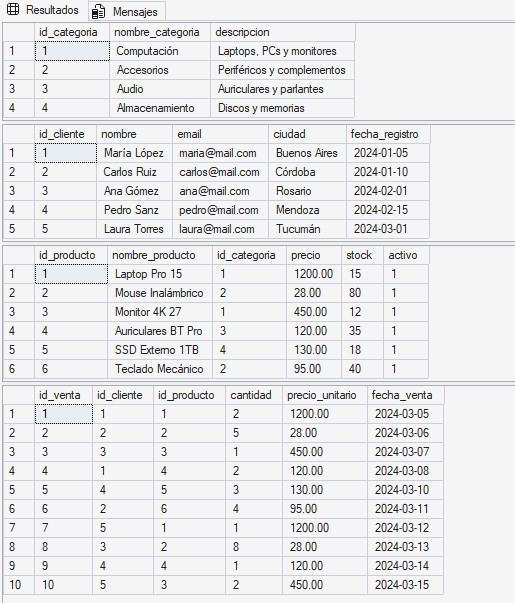
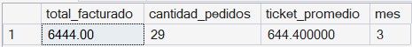
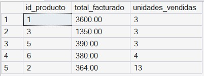
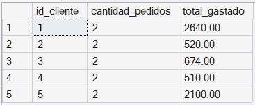
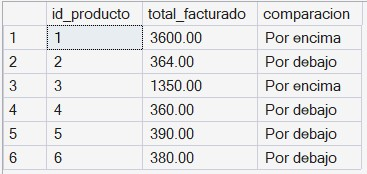
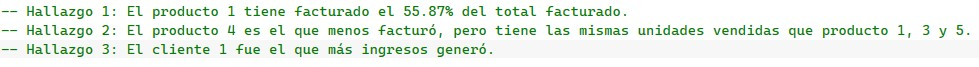
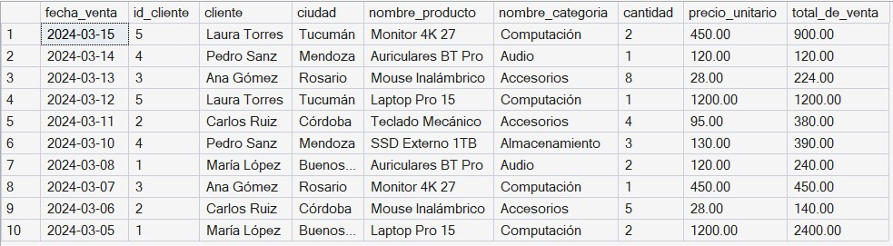
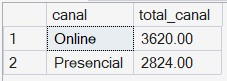

# Pre-entrega 3 – Base de datos Ventas_Tech_DB

**Curso:** Data Analytics – Coderhouse
**Autora:** Milagros Gallegos
**Motor:** SQL Server 2016 o superior

## Descripción

Script SQL que crea y carga la base de datos `Ventas_Tech_DB`, un modelo de ventas de una tienda de tecnología. El script es **repetible**: se puede ejecutar varias veces sin errores, porque borra las tablas antes de volver a crearlas.

## Modelo de datos

```
categorias (1) ──── (N) productos (1) ──── (N) ventas (N) ──── (1) clientes
```

| Tabla        | Descripción                          | Clave primaria | Claves foráneas                  |
|--------------|--------------------------------------|----------------|----------------------------------|
| `categorias` | Rubros de productos                  | `id_categoria` | —                                |
| `clientes`   | Clientes registrados                 | `id_cliente`   | —                                |
| `productos`  | Catálogo con precio y stock          | `id_producto`  | `id_categoria` → `categorias`    |
| `ventas`     | Cada venta: cliente, producto, fecha | `id_venta`     | `id_cliente`, `id_producto`      |

## Estructura del script `ventas_tech_db.sql`

1. **Preparación:** crea la base `Ventas_Tech_DB` si no existe y se posiciona en ella.
2. **DROP:** elimina las tablas en orden inverso a las dependencias (`ventas` → `productos` → `clientes` → `categorias`).
3. **CREATE:** crea las cuatro tablas con sus claves primarias, foráneas y restricciones (`NOT NULL`, `UNIQUE`, `DEFAULT`).
4. **INSERT:** carga datos de prueba en el orden de las dependencias.
5. **VALIDACIÓN:** consultas que verifican la carga:
   - contenido de cada tabla;
   - cantidad de filas por tabla frente a lo esperado (4, 5, 6 y 10).

## Cómo ejecutarlo

1. Abrir `ventas_tech_db.sql` en SQL Server Management Studio.
2. Ejecutar el script completo (F5).
3. Revisar los resultados de la sección VALIDACIÓN.

## Archivos del repositorio

| Archivo              | Contenido                                               |
|----------------------|---------------------------------------------------------|
| `ventas_tech_db.sql` | Script completo (DROP, CREATE, INSERT y VALIDACIÓN)     |
| `categorias.csv`     | Exportación de la tabla `categorias`                    |
| `clientes.csv`       | Exportación de la tabla `clientes`                      |
| `productos.csv`      | Exportación de la tabla `productos`                     |
| `resultados.csv`     | Resultados de las consultas de validación               |
| `mensajes.rpt`       | Mensajes de ejecución de SQL Server                     |
| `evidencia.jpeg`     | Captura de la ejecución del script                      |

## Evidencia de ejecución




# Pre-entrega 4 – Consultas SQL de negocio

## Descripción

Script SQL que realiza consultas sobre un modelo de ventas de una tienda de tecnología. Utiliza sentencias de agrupamiento como 'GROUP BY' o 'HAVING', de ordenamiento con 'ORDER BY', de agrecación como 'SUM' y 'AVG' y para anidar consultas con 'WITH'.












# Pre-entrega 5 – Consultas con JOINs para el proyecto

## Descripción

Scripts SQL que mejora la vista de la tabla ventas, combinandola con tabla clientes, productos y categorías.
Obtiene información para el CRM sobre Clientes que nunca compraron y productos del catálogo que no tienen ventas registradas.
Finalmente se utiliza un UNION ALL para comprar facturaciones según canal de venta correspondiente (2 criterios distintos).

Consulta 1:


Consulta 2:


Consulta 3:


Consulta 4:
